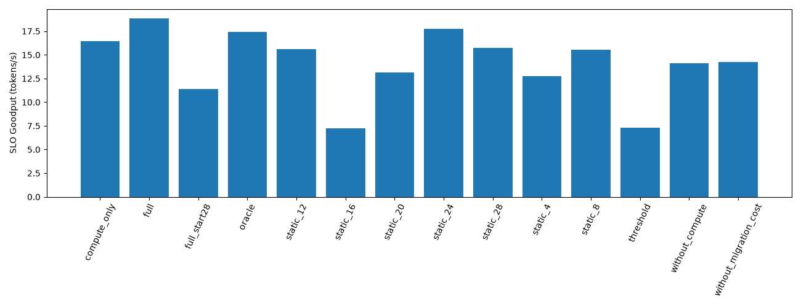
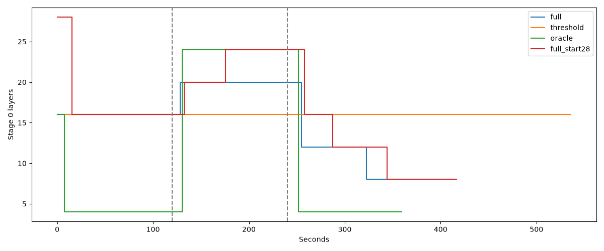

# 动态异构 GPU 调度实验

正式实验参数及请求轨迹冻结于 frozen.json；所有策略相同到达序列、模型、SLO、缓存设置及环境。

## 阶段与对照

独立 Profiling 的阶段最佳边界：{'A': 4, 'B': 24, 'C': 4}。阶段 B 为 GPU1 降速/限 KV，阶段 C 对调。
每阶段 120 秒；每 12 秒到达 4 个请求，各 32 Prompt / 96 Output Token。SLO：TTFT≤5000ms，TPOT≤100ms。
完整策略与阈值、先知策略从 16/16 启动；固定策略分别从自身边界启动。full_start28 单独量化启动配置影响。
Oracle 为已知阶段最佳边界的实测策略，计入真实迁移；另提供忽略迁移和响应时间的经验理想上界，不能视为严格数学上界。

忽略响应、迁移与跨阶段排队的经验理想 Goodput 上界：{'A': 32.0, 'B': 32.0, 'C': 32.0} Token/s，阶段均值 32.00。
## 全程实测

|策略|完成重复数|SLO Goodput Token/s 均值±标准差|吞吐|TPOT ms|TTFT ms|请求延迟 ms|迁移数均值|暂停 ms 均值|
|---|---:|---:|---:|---:|---:|---:|---:|---:|
|compute_only|5|16.46 ± 9.39|29.07|112.43|14153.73|24835.03|4.00|1307.66|
|full|5|18.88 ± 7.30|30.01|104.45|7654.01|17577.15|3.20|873.13|
|full_start28|5|11.39 ± 3.12|27.97|121.83|17578.45|29152.51|5.40|1775.45|
|oracle|5|17.42 ± 13.28|31.27|97.85|4114.98|13410.86|3.00|1242.23|
|static_12|5|15.63 ± 3.96|31.03|106.47|4748.33|14862.70|0.00|0.00|
|static_16|5|7.23 ± 0.27|21.68|164.94|43421.44|59090.65|0.00|0.00|
|static_20|5|13.15 ± 4.29|22.82|152.68|29304.26|43808.97|0.00|0.00|
|static_24|5|17.75 ± 0.76|28.32|105.69|7096.93|17137.63|0.00|0.00|
|static_28|5|15.71 ± 1.48|26.47|117.11|11392.08|22517.79|0.00|0.00|
|static_4|5|12.76 ± 6.75|30.74|108.73|19462.45|29791.47|0.00|0.00|
|static_8|5|15.57 ± 2.46|31.99|98.09|7654.57|16973.60|0.00|0.00|
|threshold|5|7.32 ± 0.97|21.96|164.74|45795.57|61445.84|0.00|0.00|
|without_compute|5|14.11 ± 8.89|26.30|128.48|22320.85|34526.43|2.20|605.58|
|without_migration_cost|5|14.23 ± 5.18|28.42|116.46|13344.65|24408.29|4.00|1220.63|

完成性：所有 14 组各 5 次完成。
全程 Best Static=static_24，完整策略 Goodput 差值 +1.13 Token/s。
Best Static 按全部阶段的整体 Goodput 选取，不能拼接各阶段不同的固定策略。
计算性能感知：full 相对 without_compute 的 Goodput 差值 +4.77 Token/s；零或负收益同样保留。
KV 风险项：full 相对 compute_only 的 Goodput 差值 +2.42 Token/s；零或负收益同样保留。
迁移成本项：full 相对 without_migration_cost 的 Goodput 差值 +4.64 Token/s；零或负收益同样保留。
初始切分位置：full 相对 full_start28 的 Goodput 差值 +7.49 Token/s；零或负收益同样保留。

阶段诊断（完整策略）：
A：平均成功 Token=3840.0，首次到达实测最佳的平均秒数=None，未到达次数=5。
B：平均成功 Token=2534.4，首次到达实测最佳的平均秒数=57.62402272224426，未到达次数=4。
C：平均成功 Token=768.0，首次到达实测最佳的平均秒数=None，未到达次数=5。
完整策略 TTFT 超标 172 次，TPOT 超标 228 次；每轮迁移总耗时均值 17367.7ms。

相对全程 Best Static 的累计 SLO 成功 Token 永久转正时间（含实际迁移损失；null 表示未回本）：{'0': None, '1': 255, '2': 193, '3': None, '4': None}。
此经验回本时间不是迁移单独因果效应；逐迁移预测成本、实际耗时及暂停保留在原始决策日志。

## 正确性与解释

Token 不一致合计：0；抢占合计：0；额外 Prefill Token：0。
analysis.json 包含各阶段预测最优序列、实测最优、响应时间、KV 峰值、排队、抢占和原始计数。
若完整策略未胜出，应结合 EWMA 响应延迟、未迁移原因、迁移次数和暂停、阶段耗时以及到达率上限解释；不能仅凭一次均值归因。
消融仍执行相同物理容量和安全可行性检查；compute_only 仅去掉 KV 风险代价，without_compute 去掉候选计算差异，without_migration_cost 去掉预测迁移代价。
模型/延迟模拟代表受控假设环境，不外推为真实异型号 GPU 的通用收益。

